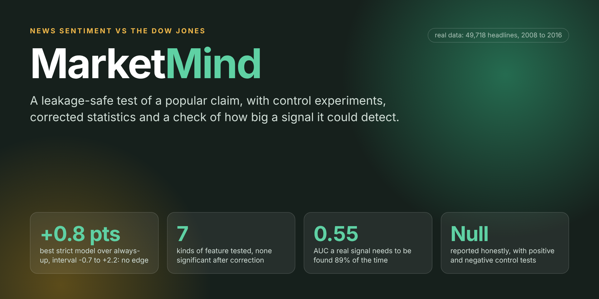
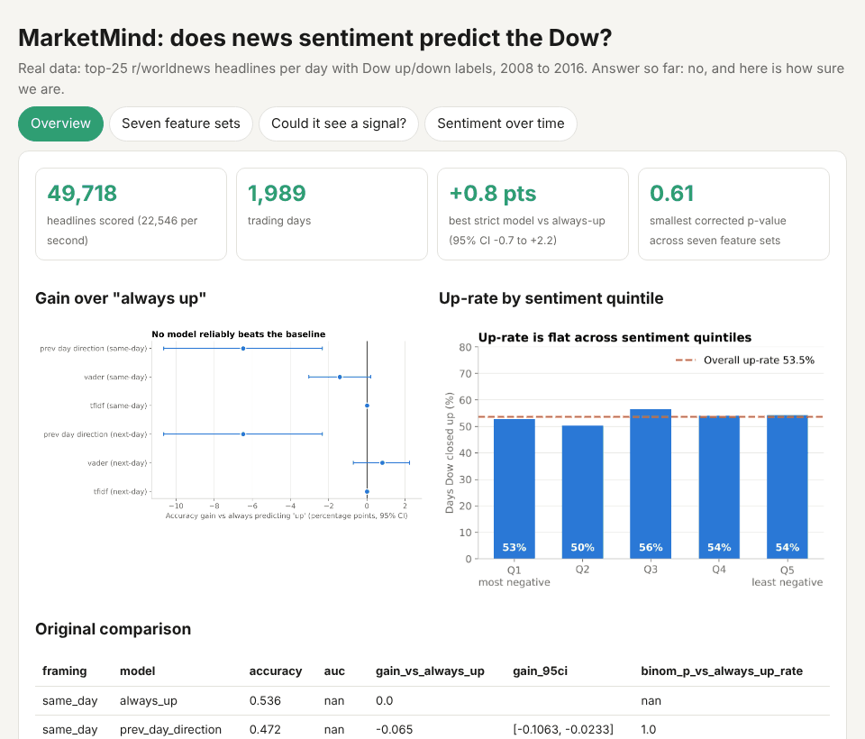

<p align="center"></p>

# MarketMind - News Sentiment vs. Stock Market Direction

[](https://github.com/Pranjaltomar07/MarketMind/actions)

*Does news sentiment predict Dow Jones direction? A leakage-safe test with control experiments.*

I wanted to test a popular claim properly: *can the sentiment of daily world-news headlines predict the direction of the Dow Jones?* The data is real: the top 25 Reddit r/worldnews headlines per day with Dow Jones up/down labels, 2008 to 2016 (1,989 days, 49,718 headlines).

**Result: no.** Under strict out-of-time evaluation no model beats "always predict up" (53.6% of days). What I took from it is the method: walk-forward testing without look-ahead, control tests that show the framework can detect a signal when one exists, and confidence intervals instead of a single accuracy number. See [FINDINGS.md](FINDINGS.md).

<p align="center"></p>

<sub>`python scripts/make_dashboard.py` builds this as one HTML file, `reports/dashboard.html`. No server needed.</sub>

| Framing (988 test days) | Model | Accuracy | Gain vs always-up (95% block-bootstrap CI) |
|---|---|---|---|
| next_day (strict) | always-up baseline | 53.6% | - |
| next_day | VADER sentiment + logistic regression | 54.5% | +0.8% [-0.7%, +2.2%] |
| next_day | TF-IDF + logistic regression | 53.6% | 0.0% (collapses to majority class; AUC 0.50) |
| same_day (optimistic) | VADER sentiment + logistic regression | 52.2% | -1.4% [-3.0%, +0.2%] |

## Run
```bash
pip install -r requirements.txt
python run_all.py            # download -> ETL -> streaming sentiment scoring -> walk-forward evaluation
streamlit run app.py
pytest -q tests              # offline; includes positive/negative control tests
python src/signal_tests.py   # stronger null-result tests (needs only reports/daily_sentiment.csv)
python scripts/make_dashboard.py
docker build -t marketmind . && docker run -p 8501:8501 marketmind
```

## Pipeline
| Stage | File |
|---|---|
| Ingest | `src/download.py` (public CSV, not redistributed), `src/etl.py` (decodes byte-string headlines, wide -> long, SQLite) |
| Stream scoring | `src/ingest.py`: bounded queue + 4 worker threads, VADER + small finance lexicon, measured throughput (~19k headlines/s in-process; a Kafka topic would replace the queue) |
| Stronger tests | `src/signal_tests.py`: seven feature sets, permutation tests with Holm correction, sub-period stability, power study |
| Dashboard | `app.py` (Streamlit) and `scripts/make_dashboard.py` (single HTML file) |
| Evaluation | `src/evaluate.py`: expanding-window walk-forward (refit every 63 days, test on 988 later days), two timing framings, block bootstrap CIs, exact binomial test |

## Why I trust the null result
- **No look-ahead:** each fold asserts `max(train date) < min(test date)`; next-day framing shifts labels forward.
- **Positive control** (`tests/`): with a planted sentiment->direction link the same code recovers a >10-point accuracy gain.
- **Negative control:** with no planted link it finds no gain.
- Gains are measured against the right baseline (always-up), not 50%, and uncertainty is reported.

## How strong is the null result?
A single "no" can mean "no signal" or "a test too weak to see one". `src/signal_tests.py` separates the two. It needs only `reports/daily_sentiment.csv`, so it runs without the raw headlines: `python src/signal_tests.py` (about 2 minutes).

| Question | What was done | Answer |
|---|---|---|
| Only one kind of feature tried? | Seven feature sets, all walk-forward: sentiment level, sentiment shock (today against its own 20-day average), 1-day change, 5/20-day averages, weekday, label momentum, all combined | Best AUC 0.513 (weekday); sentiment level 0.470. None beats a coin flip |
| Luck? | Circular-shift permutation test (keeps autocorrelation) with Holm correction over seven looks | Smallest raw p = 0.087; smallest corrected p = 0.61 |
| Stable over time? | AUC in three consecutive sub-periods | Moves between 0.42 and 0.53, around 0.5 |
| Could the test see a real signal? | Planted a signal of known strength in the real sentiment series and re-ran the same code | 5% false alarms with nothing planted; a signal worth AUC 0.55 is found 89% of the time; 80% power needs about AUC 0.546 |

**What this does and does not rule out:** with 988 test days, a signal as strong as AUC 0.55 or more would almost surely have shown up, so effects that large are ruled out. Effects much smaller than that cannot be excluded with this dataset. Results are in `reports/signal_tests.csv`, `signal_power.csv` and `signal_subperiods.csv`.

## Limitations
VADER is a general-purpose lexicon, and a finance-specific model such as FinBERT would be the next step. Daily aggregation discards intraday timing. The dataset has labels but no prices, so I did not attempt a return-based backtest.

## Results at a glance


## How this was built
I designed, coded and implemented this project, and used GenAI tools as an assistant for drafting and debugging. I tested and validated it myself: every fold asserts that training dates precede test dates, positive and negative control tests check that the framework finds a planted signal and finds nothing when none exists, and every number in this README comes from running the code in this repository.

## Author
Pranjal Tomar ([@Pranjaltomar07](https://github.com/Pranjaltomar07)). Part of my [portfolio](https://github.com/Pranjaltomar07).
